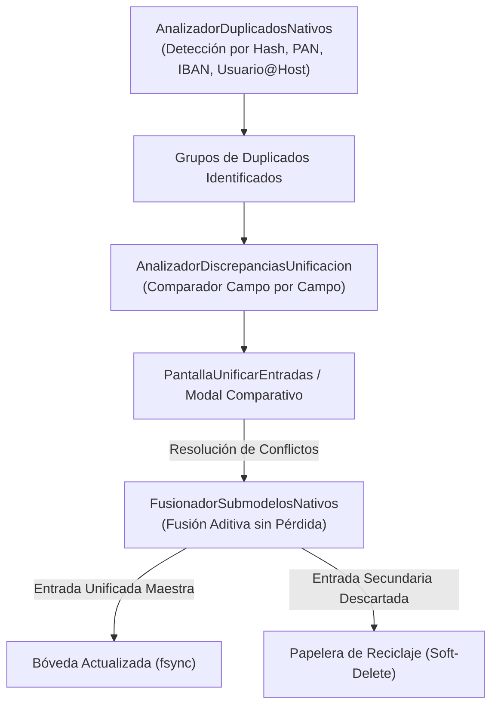
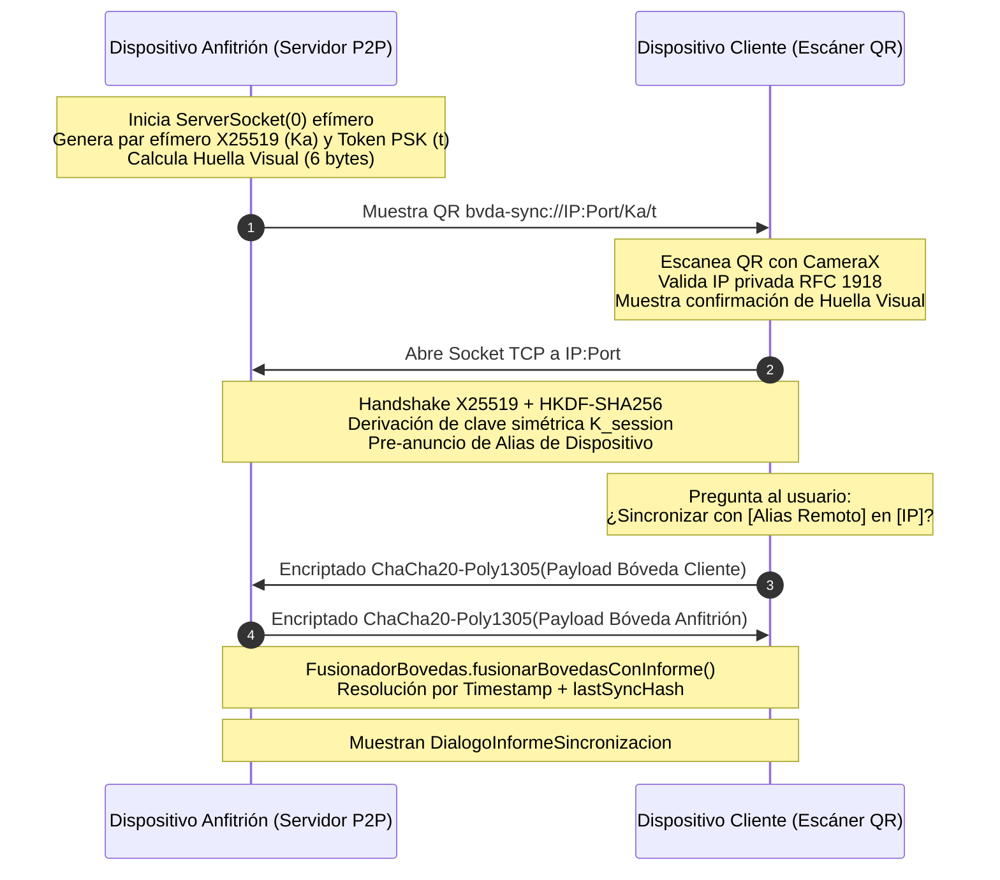
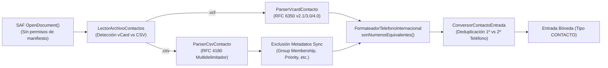
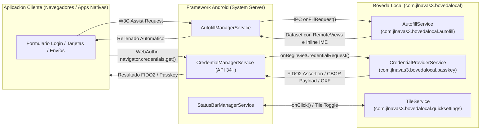

# Arquitectura Técnica de Bóveda Local

[](https://github.com/)
[-DEA584.svg?logo=rust&logoColor=white)](https://github.com/jlnavas3/boveda-desktop)
[]()
[]()

## Especificación Formal de Ingeniería y Seguridad Criptográfica

**Bóveda Local** (`com.jlnavas3.bovedalocal`) es una plataforma soberana y offline de gestión de credenciales, autenticación de dos factores (**TOTP RFC 6238**), proveedor nativo de llaves de acceso (**Passkeys / WebAuthn FIDO2**), generador de claves SSH, alias de correo RFC 5233, suite de contactos confidenciales y normalización inteligente de identidades para el sistema operativo Android.

La aplicación opera bajo el principio de **Confianza Cero en Red (Zero-Network Architecture)** y cuenta con dos variantes de compilación (*Build Flavors*):
* **Sabor `airgapped`:** Aislamiento total de red (permiso `android.permission.INTERNET` purgado de raíz). Imposibilidad física de emitir tráfico telemático desde el espacio de usuario.
* **Sabor `lanSync`:** Permite sincronización peer-to-peer cifrada en red local privada (**Wi-Fi / Hotspot RFC 1918**) y transporte óptico de aislamiento físico (**Airgap por ráfagas QR `bvda-opt://`**) con cero dependencias de servidores en la nube.

Este documento detalla la topología de diseño, la orquestación reactiva del estado, la máquina criptográfica formal, los protocolos de sincronización P2P y óptica, los contratos inter-proceso (IPC) con el framework de Android, la parametrización dinámica y el estándar de **Micro-Diseño (1 archivo = 1 composable/clase)** adoptado en el código fuente, garantizando su completa interoperabilidad y simetría con la plataforma de escritorio [**Bóveda Local Desktop**](https://github.com/jlnavas3/boveda-desktop) (escrita en Rust para Linux y Windows).

---

## 1. Topología Arquitectónica y Principios de Diseño

El sistema implementa una variante estricta de **Clean Architecture** combinada con **MVI/MVVM (Model-View-Intent / Model-View-ViewModel)**, **Flujo Unidireccional de Datos (UDF - Unidirectional Data Flow)** y un modelo de **Micro-Diseño Atómico** sobre Jetpack Compose.

```mermaid
flowchart TD
    subgraph UI_Presentation ["Capa de Presentación (Jetpack Compose & Micro-Diseño)"]
        Atoms["Micro-Componentes UI Atómicos<br/>(1 Archivo = 1 Composable)"]
        Prevs["@BovedaPreview<br/>(Vistas Previas Aisladas en Editor)"]
        Screens["Pantallas de Dominio y Módulos<br/>(ui/pantallas/*)"]
        Tokens["Tokens de Diseño Dinámicos<br/>(Bordes, Curvatura, Espaciado, Tipografía)"]
    end

    subgraph State_Coordination ["Capa de Coordinación y Estado (MVI Facade & 17 Delegados)"]
        VM["VaultViewModel (Facade Central Liviano)"]
        
        subgraph Sub_Ciclo ["Ciclo de Vida y Dominio"]
            DelNav["VaultViewModelNavegacion<br/>(Pila LIFO ArrayDeque)"]
            DelEnt["VaultViewModelEntradas<br/>(CRUD, Búsqueda Fonética)"]
            DelCic["VaultViewModelCicloBoveda<br/>(Máquina de Estados, Autodestrucción)"]
            DelBkp["VaultViewModelBackup<br/>(SAF, Exportación .bvda, CSV)"]
            DelTit["VaultTitulosDelegate<br/>(Reglas de Títulos y Homelab)"]
            DelDup["VaultDuplicadosPapeleraDelegate<br/>(Detección, Fusión, Lotes Papelera)"]
            DelAvi["VaultAvisosDelegate<br/>(Asistencia Interna In-App)"]
        end
        
        subgraph Sub_Ajustes ["Delegados Especializados de Ajustes"]
            DelSeg["VaultAjustesSeguridadDelegate"]
            DelOrg["VaultAjustesOrganizacionDelegate"]
            DelCol["VaultAjustesColoresTemaDelegate"]
            DelGeo["VaultAjustesFormasTipografiaDelegate"]
            DelEng["VaultAjustesAnimacionEngranajesDelegate"]
            DelInt["VaultAjustesInteraccionDelegate"]
            DelDic["VaultAjustesDiccionariosDelegate"]
            DelWid["VaultAjustesWidgetTotpDelegate / 1x1"]
            DelTil["VaultAjustesTileTotpManualDelegate"]
        end
    end

    subgraph Domain_Repo ["Capa de Dominio, Repositorio y Parametrización"]
        Defaults["AjustesDefaults.kt<br/>(Fuente Única de la Verdad - 23 Bloques)"]
        Repo["VaultRepository<br/>(Orquestador I/O y Cifrado)"]
        Almacen["AlmacenAjustes.kt<br/>(StateFlow<AjustesApp>)"]
        Models["Modelos Inmutables (Entrada, AjustesApp, Perfil, ContenidoBoveda)"]
        FusionNative["Motor de Unificación sin Pérdidas (AnalizadorDiscrepancias + Fusionador)"]
    end

    subgraph Sync_Engine ["Motor de Sincronización Soberana P2P y Óptica"]
        ServerP2P["ServidorSyncP2P (Socket Efímero ServerSocket(0))"]
        ClientP2P["ClienteSyncP2P (Handshake X25519 + ChaCha20)"]
        IpDetector["DetectorIpLanAndroid (wlan*, ap*, rndis*, eth*)"]
        RfcFilter["ValidadorRfc1918 (10/8, 172.16/12, 192.168/16)"]
        OptCodec["CodecDeltaOptico (Chunking 300B + lastSyncHash)"]
        OptAssembler["EnsambladorDeltaOptico (Reconstrucción Ráfaga)"]
        VaultFusion["FusionadorBovedas (Three-Way Merge + lastSyncHash)"]
    end

    subgraph Contacts_Pipeline ["Pipeline de Contactos Seguros Zero-Permissions"]
        ContactReader["LectorArchivoContactos (Enrutador Heurístico)"]
        VcardParser["ParserVcardContacto (RFC 6350 vCard 2.1/3.0/4.0)"]
        CsvParser["ParserCsvContacto (RFC 4180 + Filtro Metadatos Sync)"]
        PhoneDedup["FormateadorTelefonoInternacional (sonNumerosEquivalentes)"]
        ContactConv["ConversorContactoEntrada (Zero-Loss Custom Fields)"]
    end

    subgraph Crypto_Engine ["Motor Criptográfico y Aislamiento de Memoria"]
        KDF["Argon2id KDF<br/>(RFC 9106, 0x13, 64-256 MiB)"]
        AES["AES-256-GCM<br/>(NIST SP 800-38D, AAD de 49 Bytes)"]
        ChaCha["ChaCha20-Poly1305<br/>(RFC 8439 para Sincronización)"]
        X25519["X25519 + HKDF-SHA256<br/>(RFC 7748 / RFC 5869)"]
        BLZ["CompresorBoveda (BLZ1 / Deflate)"]
        Zero["Zeroizar.kt<br/>(Sobrescritura Forzada en RAM 0x00)"]
        Keystore["BiometricKeyStore<br/>(StrongBox / TEE Hardware Binding)"]
        SSH["GeneradorClavesSsh (Ed25519/RSA/ECDSA)"]
    end

    subgraph Persistence ["Persistencia e Integridad de Archivo"]
        FS["Almacenamiento Local<br/>(boveda.bvda con fsync atómico)"]
        SAF["Storage Access Framework<br/>(Exportación/Importación .bvda, CSV, vCard)"]
    end

    subgraph Android_System ["Integración de Servicios del Sistema"]
        Autofill["AutofillService<br/>(W3C Heuristics, IME Inline, Tarjetas/Direcciones)"]
        CredMan["CredentialProviderService<br/>(Passkeys / CBOR Parser / CXF)"]
        Tile["TileService<br/>(Quick Settings Generator)"]
        Widget["Glance / AppWidget<br/>(2FA TOTP y 1x1 Generator)"]
    end

    %% Relaciones
    UI_Presentation -->|"Intents / Eventos de Usuario"| VM
    VM --> Sub_Ciclo & Sub_Ajustes
    Sub_Ciclo & Sub_Ajustes -->|"Casos de Uso / Consultas"| Repo
    Defaults -.->|"Valores Predeterminados Canónicos"| Almacen
    Repo --> Almacen & KDF & AES & BLZ & Zero & Keystore
    Repo --> FusionNative
    Repo -->|"Escritura Atómica temp + renameTo"| FS
    DelBkp -->|"DocumentFile / Stream"| SAF
    VM -->|"StateFlow / Compose Snapshots"| UI_Presentation
    Android_System <-->|"IPC Binder / Intent Resolver"| VM
    
    Sync_Engine --> VaultFusion
    VaultFusion --> Repo
    Contacts_Pipeline --> VM
```



### Principios Fundamentales
1. **Separación de Responsabilidades Unidireccional (UDF):** Los componentes de interfaz de usuario emiten eventos e intenciones de forma ascendente. Los delegados procesan la lógica de negocio y emiten instantáneas inmutables de estado (`StateFlow`) hacia abajo.
2. **Estricto Micro-Diseño (1 archivo = 1 composable/clase/función):** Se prohíben archivos monolíticos o definiciones múltiples en un solo archivo fuente. Cada micro-componente, diálogo, fila o tarjeta reside en su propio archivo con su correspondiente vista previa `@BovedaPreview`.
3. **Cero Hardcoding (Fuente Única de la Verdad):** Todos los valores por defecto de la aplicación están unificados de forma canónica en [`AjustesDefaults.kt`](app/src/main/java/com/jlnavas3/bovedalocal/data/AjustesDefaults.kt). Ningún valor predeterminado se encuentra hardcodeado en la interfaz ni en la lógica de negocio.
4. **Inmutabilidad de Datos en Tránsito:** Las estructuras de datos del dominio (`Entrada`, `AjustesApp`, `Perfil`, `PlantillaCamposPersonalizada`, `ContenidoBoveda`) son `data class` inmutables. Toda mutación genera una nueva copia, facilitando el tracking de recomposiciones en Compose.
5. **Tolerancia Cero a Strings en Material Sensible:** Las contraseñas maestras y claves criptográficas efímeras se procesan exclusivamente en buffers primitivos (`CharArray`, `ByteArray`) y se sobrescriben con `0x00` en memoria RAM tras su uso inmediato vía [`Zeroizar.kt`](app/src/main/java/com/jlnavas3/bovedalocal/crypto/Zeroizar.kt).
6. **Zero-Permissions Architecture:** Eliminación total de permisos invasivos en tiempo de ejecución (como `READ_CONTACTS`). La ingesta de archivos externos se realiza exclusivamente mediante Storage Access Framework (`OpenDocument`), delegando el control al usuario sin conceder permisos de lectura al almacenamiento general.

---

## 2. Tipos de Datos Nativos y Capa de Dominio Expandida

Bóveda Local cuenta con soporte nativo fuertemente tipado para **9 tipos de entrada** (`TipoEntrada.kt`), cada uno con su propio modelo de datos inmutable, serialización transparente y componentes desacoplados de edición y detalle:

| Tipo (`TipoEntrada`) | Modelo de Subdatos | Capacidades y Validaciones Clave |
| :--- | :--- | :--- |
| `LOGIN` | Estructura base de `Entrada` | Usuario, contraseña con zxcvbn, URLs múltiples, TOTP primario y secundario, passkey, alias `@` y campos personalizados. |
| `NOTA` | Integrado con `AplicadorFormatoMarkdown` | Formato Markdown enriquecido, soporte de **tablas estructuradas completas**, listas `[x]`, bloques de código y vista previa reactiva. |
| `TARJETA` | `DatosTarjetaBancaria.kt` | Número PAN verificado con **Algoritmo de Luhn**, fecha expiración MM/AA, CVV/CVC, tipo de tarjeta y titular. |
| `WIFI` | `DatosWifi.kt` | SSID, contraseña, cifrado (WPA2, WPA3, WEP, Abierta) y visibilidad oculta. |
| `CUENTA_BANCARIA`| `DatosCuentaBancaria.kt` | Entidad financiera, IBAN/Número de cuenta internacional, código BIC/SWIFT y titular. |
| `IDENTIDAD` | `DatosIdentidad.kt` | Tipo de documento (DNI, Pasaporte, Licencia, Cédula), número, fechas emisión/expiración y país emisor. |
| `SERVIDOR` | `DatosServidorSsh.kt` | Host/IP, puerto SSH (por defecto 22), usuario, clave privada PEM, clave pública OpenSSH y huella SHA-256. |
| `WALLET` | `DatosWallet.kt` | Frase semilla mnemónica BIP-39 (12 o 24 palabras) con comprobación contra diccionario offline, clave pública y blockchain. |
| `CONTACTO` | `DatosContacto.kt` | Nombre, teléfono principal, teléfono secundario deduplicado, correo, dirección de entrega física, empresa, cargo, campos personalizados y suite de comunicación confidencial. |

---

## 3. Motor de Unificación Inteligente sin Pérdidas (*Lossless Merge*)

Para resolver el problema clásico de credenciales duplicadas sin destruir datos históricos o secundarios, Bóveda Local implementa una arquitectura de fusión en tres etapas:



1. **Detección Multimodelo:** Compara entradas maestras y secundarias por contraseña idéntica, mismo número de tarjeta (PAN), mismo IBAN bancario, mismo documento de identidad y combinaciones de usuario en el mismo dominio.
2. **Comparador de Discrepancias ([`AnalizadorDiscrepanciasUnificacion.kt`](app/src/main/java/com/jlnavas3/bovedalocal/data/AnalizadorDiscrepanciasUnificacion.kt)):** Expone qué campos difieren entre la entrada principal y las secundarias (contraseña, URLs, notas, campos personalizados, etiquetas, adjuntos).
3. **Fusión Aditiva ([`FusionadorSubmodelosNativos.kt`](app/src/main/java/com/jlnavas3/bovedalocal/data/FusionadorSubmodelosNativos.kt)):** Concatena notas con marcas de tiempo, transfiere adjuntos únicos, combina etiquetas sin repetición, absorbe códigos TOTP secundarios y envía la entrada obsoleta a la papelera manteniendo su historial intacto.

---

## 4. Orquestación del Estado: Patrón Facade y 17 Delegados Reactivos

Para evitar la sobrecarga del controlador central (`VaultViewModel`), se implementó el patrón **Facade con Composición de Delegados**. El ViewModel central actúa como un orquestador liviano que expone el estado global e intercomunica **17 delegados y sub-delegados especializados**:

| Delegado | Archivo | Responsabilidad Arquitectónica |
| :--- | :--- | :--- |
| **`VaultViewModelNavegacion`** | [`VaultViewModelNavegacion.kt`](app/src/main/java/com/jlnavas3/bovedalocal/ui/VaultViewModelNavegacion.kt) | Pila LIFO en memoria (`ArrayDeque<Pantalla>`), retorno multinivel estricto nivel a nivel, índice exhaustivo de búsqueda ([`IndiceBusquedaAjustes.kt`](app/src/main/java/com/jlnavas3/bovedalocal/ui/pantallas/ajustes/IndiceBusquedaAjustes.kt)) y enrutamiento $O(1)$ por identificadores Tri-Grama `irPorId()`. |
| **`VaultViewModelEntradas`** | [`VaultViewModelEntradas.kt`](app/src/main/java/com/jlnavas3/bovedalocal/ui/VaultViewModelEntradas.kt) | Operaciones CRUD de credenciales, ordenación multi-criterio, motor de búsqueda fonética y filtrado por identidades/categorías. |
| **`VaultViewModelCicloBoveda`** | [`VaultViewModelCicloBoveda.kt`](app/src/main/java/com/jlnavas3/bovedalocal/ui/VaultViewModelCicloBoveda.kt) | Máquina de estados (cerrada, abierta, señuelo), freno anti-fuerza bruta en disco, autodestrucción por PIN y wipe tras exceder intentos fallidos permitidos. |
| **`VaultViewModelBackup`** | [`VaultViewModelBackup.kt`](app/src/main/java/com/jlnavas3/bovedalocal/ui/VaultViewModelBackup.kt) | Copias de seguridad automáticas y manuales con SAF, exportación `.bvda` cifrada e importador CSV universal autodetectable. |
| **`VaultTitulosDelegate`** | [`VaultTitulosDelegate.kt`](app/src/main/java/com/jlnavas3/bovedalocal/ui/VaultTitulosDelegate.kt) | Normalización de títulos de sitios web, reglas de subdominios, marcas oficiales y mapeo de servicios en redes locales (Homelab). |
| **`VaultDuplicadosPapeleraDelegate`** | [`VaultDuplicadosPapeleraDelegate.kt`](app/src/main/java/com/jlnavas3/bovedalocal/ui/VaultDuplicadosPapeleraDelegate.kt) | Detección inteligente de credenciales duplicadas, selección múltiple para fusión y gestión de papelera con selección por lotes y purga temporal programada. |
| **`VaultAvisosDelegate`** | [`VaultAvisosDelegate.kt`](app/src/main/java/com/jlnavas3/bovedalocal/ui/VaultAvisosDelegate.kt) | Centro de Asistencia y recomendaciones internas In-App (duplicados, títulos crudos, salud global y recordatorios de respaldo con cálculo de tiempo transcurrido). |
| **`VaultAjustesSeguridadDelegate`** | [`VaultAjustesSeguridadDelegate.kt`](app/src/main/java/com/jlnavas3/bovedalocal/ui/VaultAjustesSeguridadDelegate.kt) | Biometría, auto-bloqueo, borrado de portapapeles, FLAG_SECURE, freno de fuerza bruta, seguridad visual y límite de intentos antes de autodestrucción. |
| **`VaultAjustesOrganizacionDelegate`** | [`VaultAjustesOrganizacionDelegate.kt`](app/src/main/java/com/jlnavas3/bovedalocal/ui/VaultAjustesOrganizacionDelegate.kt) | Jerarquía de identidades/categorías, densidad de lista, índice Niagara, formatos numéricos/regionales, recordatorios de respaldo y plantillas de campos personalizadas. |
| **`VaultAjustesColoresTemaDelegate`** | [`VaultAjustesColoresTemaDelegate.kt`](app/src/main/java/com/jlnavas3/bovedalocal/ui/VaultAjustesColoresTemaDelegate.kt) | 20 paletas de acento, paletas sobrias (Gris Acero, Arena, Pizarra, Carbón, Niebla), colores funcionales y sincronización Material You. |
| **`VaultAjustesFormasTipografiaDelegate`** | [`VaultAjustesFormasTipografiaDelegate.kt`](app/src/main/java/com/jlnavas3/bovedalocal/ui/VaultAjustesFormasTipografiaDelegate.kt) | Curvatura de esquinas (0–32 dp), estilo de bordes (Delgado, Grueso, Sólido, Neón), espaciado entre tarjetas, escala tipográfica e interlineado proporcional. |
| **`VaultAjustesAnimacionEngranajesDelegate`**| [`VaultAjustesAnimacionEngranajesDelegate.kt`](app/src/main/java/com/jlnavas3/bovedalocal/ui/VaultAjustesAnimacionEngranajesDelegate.kt)| Física y renderizado vectorial del mecanismo de engranajes relojeros y anillos concéntricos de la puerta de bóveda. |
| **`VaultAjustesInteraccionDelegate`** | [`VaultAjustesInteraccionDelegate.kt`](app/src/main/java/com/jlnavas3/bovedalocal/ui/VaultAjustesInteraccionDelegate.kt) | Respuesta háptica global de la app, destello/alumbrado visual de filas en deep-links y capacidad en memoria del buffer de eventos. |
| **`VaultAjustesDiccionariosDelegate`** | [`VaultAjustesDiccionariosDelegate.kt`](app/src/main/java/com/jlnavas3/bovedalocal/ui/VaultAjustesDiccionariosDelegate.kt) | Gestión reactiva de diccionarios Diceware BIP-39 (Español e Inglés), catálogo de contraseñas comunes, adición/edición de términos y cálculo de entropía. |
| **`VaultAjustesWidgetTotpDelegate`** | [`VaultAjustesWidgetTotpDelegate.kt`](app/src/main/java/com/jlnavas3/bovedalocal/ui/VaultAjustesWidgetTotpDelegate.kt) | Calibración de bordes, curvaturas, transparencia, efecto vidrio esmerilado (*frosted glass*) y háptica en el widget de favoritos 2FA. |
| **`VaultAjustesWidget1x1Delegate`** | [`VaultAjustesWidget1x1Delegate.kt`](app/src/main/java/com/jlnavas3/bovedalocal/ui/VaultAjustesWidget1x1Delegate.kt) | Modo de generación (aleatoria/Diceware/patrón), dimensiones asimétricas, offsets y sincronización con longitud máxima (hasta 128 caracteres). |
| **`VaultAjustesTileTotpManualDelegate`** | [`VaultAjustesTileTotpManualDelegate.kt`](app/src/main/java/com/jlnavas3/bovedalocal/ui/VaultAjustesTileTotpManualDelegate.kt) | Parámetros del Quick Settings Tile de Android y algoritmos/períodos del generador manual de códigos TOTP. |

---

## 5. Pipeline Criptográfico y Formato Binario `.bvda`

El archivo físico `boveda.bvda` comienza con una cabecera binaria inmutable de **49 bytes**, inyectada como **Datos Asociados Autenticados (AAD)**:

```text
Offset (Bytes)   Longitud (Bytes)   Campo               Descripción
----------------------------------------------------------------------------------------
00..03           04                 MAGIC               Glifo constante 0x42 0x56 0x44 0x41 ("BVDA")
04               01                 VERSION             Versión de esquema binario (0x01)
05..20           16                 SALT                Sal criptográfica CSPRNG para Argon2id
21..24           04                 MEMORY_KIB          Memoria RAM asignada a Argon2id (Big Endian)
25..28           04                 ITERATIONS          Iteraciones de paso para Argon2id (Big Endian)
29..32           04                 PARALLELISM         Lanes de paralelismo para Argon2id (Big Endian)
33..36           04                 HASH_LENGTH         Longitud de salida de clave = 32 (Big Endian)
37..48           12                 NONCE               Vector de inicialización único para AES-GCM
----------------------------------------------------------------------------------------
Total Cabecera:  49 Bytes
49..N-16         Variable           CIPHERTEXT          Datos comprimidos (BLZ1) y cifrados (AES-GCM)
N-16..N          16                 TAG_GCM             Etiqueta de autenticación de 128 bits
```

### Compresión BLZ1
El cuerpo plano antes de cifrar pasa por `CompresorBoveda.kt`:
* Si el stream descomprimido comienza con `0x42 0x4C 0x5A 0x31` (`"BLZ1"`), el resto se procesa como un stream Deflate zlib.
* Si no incluye la cabecera mágica, se procesa en texto plano JSON directo (retrocompatibilidad garantizada con copias históricas).

---

## 6. Topología y Protocolos de Sincronización Cifrada (P2P y Óptica)

Bóveda Local cuenta con un subsistema desacoplado de sincronización soberana en el paquete `com.jlnavas3.bovedalocal.sync`, diseñado bajo la premisa de **Confianza Cero en la Red**, operando con simetría criptográfica y compatibilidad total con la plataforma de escritorio [**Bóveda Local Desktop**](https://github.com/jlnavas3/boveda-desktop):



### 1. Protocolo P2P Red Local (`bvda-sync://`)
* **Detección de Interfaces Seguras ([`DetectorIpLanAndroid.kt`](app/src/main/java/com/jlnavas3/bovedalocal/sync/DetectorIpLanAndroid.kt)):** Inspecciona `NetworkInterface.getNetworkInterfaces()`, incluyendo interfaces Wi-Fi (`wlan*`), Hotspot/Tethering directo (`ap*`, `swlan*`, `rndis*`) y Ethernet (`eth*`), descartando interfaces inactivas, loopback y túneles VPN/móviles (`rmnet*`, `tun*`, `wg*`).
* **Filtro RFC 1918 Estricto ([`ValidadorRfc1918.kt`](app/src/main/java/com/jlnavas3/bovedalocal/sync/ValidadorRfc1918.kt)):** Valida que la IP pertenezca a los rangos `10.0.0.0/8`, `172.16.0.0/12` o `192.168.0.0/16`. Cualquier intento de conexión fuera de estos rangos es abortado de inmediato.
* **Handshake Criptográfico:** Par efímero de curva elíptica **X25519 (RFC 7748)** + derivación de clave **HKDF-SHA256 (RFC 5869)** con el token efímero PSK (`t`) como `info` del HKDF. El túnel de datos se cifra mediante **ChaCha20-Poly1305 (RFC 8439)**.
* **Huella Visual de Emparejamiento ([`HuellaVisualSync.kt`](app/src/main/java/com/jlnavas3/bovedalocal/sync/HuellaVisualSync.kt)):** Deriva un hash visual de 6 bytes en formato canónico hexadecimal (`XX:XX:XX:XX:XX:XX`) a partir del material de claves de ambos extremos para que el usuario valide que no existe ningún intermediario (MITM).
* **Confirmación Previa de Identidad:** Ambos extremos anuncian su alias de dispositivo (`IdentidadDispositivoLocal.obtenerNombre()`, ej. `HONOR DNP-NX9` o `Xiaomi 22101320G`) antes de proceder con la transmisión de la bóveda.

### 2. Transporte Óptico Cifrado Airgap (`bvda-opt://`)
* **Aislamiento Total por Ráfagas QR:** Permite transferir datos entre dos dispositivos completamente desconectados de cualquier red (modo avión), empleando exclusivamente la pantalla de uno y la cámara del otro.
* **Cifrado con PIN de 6 Dígitos:** La carga útil se cifra con **ChaCha20-Poly1305**, utilizando una clave derivada en tiempo real a partir del PIN numérico de 6 dígitos mediante **Argon2id** (con sal pública aleatoria de 16 bytes).
* **Chunking y Ráfaga a 200 ms ([`CodecDeltaOptico.kt`](app/src/main/java/com/jlnavas3/bovedalocal/sync/CodecDeltaOptico.kt)):** Los datos comprimidos se fragmentan en bloques binarios de 300 bytes, garantizando códigos QR de módulos grandes y alto contraste legibles a 5 FPS sin desenfoque de movimiento.
* **Modo "Cambios Recientes (1 QR)":** Utiliza `lastSyncHash` para aislar exclusivamente las entradas modificadas o enviadas a papelera recientemente. Si no hay cambios, sintetiza un testigo de sincronización generando **un único código QR estático**.
* **Modo "Bóveda Completa":** Ráfaga cíclica indexada (`bvda-opt://v1/s/.../f/{seq}/{total}/{chunkB64}`) que [`EnsambladorDeltaOptico.kt`](app/src/main/java/com/jlnavas3/bovedalocal/sync/EnsambladorDeltaOptico.kt) ensambla asíncronamente en cualquier orden de escaneo.

### 3. Fusión Tridireccional de Bóvedas ([`FusionadorBovedas.kt`](app/src/main/java/com/jlnavas3/bovedalocal/sync/FusionadorBovedas.kt))
* **Resolución por Timestamp:** Compara `modificadaEn` y preserva el estado más reciente de cada entrada.
* **Preservación de Tumbas de Borrado (*Tombstones*):** Si una entrada reside en la papelera en un extremo pero tiene fecha de eliminación posterior a la última modificación remota, se preserva como eliminada. Si fue editada remotamente después de borrada, se revive como activa.
* **Seguimiento por Hash (`lastSyncHash`):** Calcula el hash de contenido canónico mediante [`CalculadorHashEntrada.kt`](app/src/main/java/com/jlnavas3/bovedalocal/sync/CalculadorHashEntrada.kt) y lo asigna a `entrada.lastSyncHash`, permitiendo detectar cambios incrementales instantáneos en sincronizaciones subsiguientes.

---

## 7. Pipeline de Contactos Zero-Permissions y Deduplicación Canónica

Bóveda Local prescinde por diseño de los permisos invasivos del sistema (`android.permission.READ_CONTACTS`). La gestión de contactos se estructura como un pipeline desacoplado:



### 1. Ingesta Multi-Formato sin Permisos
* **Selector del Sistema SAF:** El usuario selecciona el archivo `.vcf` o `.csv` mediante el selector nativo del sistema operativo. La app solo recibe un stream temporal de solo lectura sin acceder a la libreta del teléfono.
* **Parser vCard RFC 6350 ([`ParserVcardContacto.kt`](app/src/main/java/com/jlnavas3/bovedalocal/data/contactos/ParserVcardContacto.kt)):** Soporta vCard 2.1, 3.0 y 4.0 con despliegue de líneas continuadas (*line folding*), decodificación Quoted-Printable (UTF-8, ISO-8859-1, Windows-1252) y des-escape de caracteres.
* **Parser CSV RFC 4180 ([`ParserCsvContacto.kt`](app/src/main/java/com/jlnavas3/bovedalocal/data/contactos/ParserCsvContacto.kt)):** Detección automática de delimitador (`,` o `;`), soporte de celdas multilínea, comillas escapadas y mapeo inteligente de cabeceras en español e inglés.
* **Exclusión de Metadatos de Sincronización:** Descarta automáticamente columnas internas de sincronización en la nube (`Group Membership`, `Priority`, `Sensitivity`, `Subject`, `Photo`, `Mileage`, etc.) para evitar polución de campos personalizados.
* **Selector de Contacto Único ([`ModalSeleccionContactoUnico.kt`](app/src/main/java/com/jlnavas3/bovedalocal/ui/pantallas/contactos/ModalSeleccionContactoUnico.kt)):** Permite seleccionar un contacto específico cuando se autorrellena desde archivos con múltiples entradas.

### 2. Deduplicación Canónica de Telefonía ([`FormateadorTelefonoInternacional.kt`](app/src/main/java/com/jlnavas3/bovedalocal/data/contactos/FormateadorTelefonoInternacional.kt))
* **Detección de Equivalencia (`sonNumerosEquivalentes`):** Compara dos cadenas telefónicas a tres niveles:
  1. *Limpieza de puntuación:* Quita guiones, paréntesis, barras, puntos y espacios (`limpiarParaDiscado`). Detecta equivalencia entre `+59399-461-5671` y `+593994615671`.
  2. *Sólo dígitos:* Compara el valor numérico absoluto ignorando el prefijo `+` (ej. `593994615671` vs `+593994615671`).
  3. *Formato local vs Internacional:* Normaliza ceros iniciales de llamadas domésticas frente al prefijo internacional E.164 (ej. `0994615671` vs `+593994615671` o `(555) 234-5678` vs `+1-555-234-5678`), comprobando coincidencia en el número nacional de abonado.
* **Selección de la Mejor Representación (`mejorRepresentacion`):** Preserva la variante más completa (priorizando el prefijo internacional `+`).
* **Blindaje en Conversión:** [`ConversorContactoEntrada.kt`](app/src/main/java/com/jlnavas3/bovedalocal/data/contactos/ConversorContactoEntrada.kt) garantiza que `telefonoSecundario` nunca duplique al principal y que ningún teléfono adicional en `camposPersonalizados` sea redundante.

---

## 8. Integración de Servicios del Sistema Android e IPC



1. **Android Autofill Framework (`AutofillService`):**
   - Intercepta solicitudes del sistema operativo en formularios de inicio de sesión, tarjetas bancarias y direcciones.
   - Detecta el nombre amigable e ícono real de apps instaladas, desplegando sugerencias en `RemoteViews` y chips inline en el teclado (IME).
2. **Credential Provider Platform (Android 14+ / API 34+):**
   - Actúa como proveedor nativo de **Passkeys** y credenciales FIDO2/WebAuthn. Procesa peticiones codificadas en CBOR, genera aserciones firmadas con curvas elípticas NIST P-256 (ES256) y soporta el estándar de intercambio interoperable **CXF (Credential Exchange Format)** de la FIDO Alliance.
3. **Panel de Ajustes Rápidos (`TileService`):**
   - Generación de contraseñas criptográficas seguras instantáneas directamente desde la cortina de notificaciones sin requerir desbloqueo de la bóveda.
4. **Widgets de Escritorio:**
   - Visualización reactiva de códigos TOTP 2FA con efecto de vidrio esmerilado y generación rápida 1x1.

---

## 9. Directrices de Calidad, Compilación y Verificación

1. **Batería de Pruebas Unitarias Automatizadas:** El repositorio cuenta con **690 pruebas unitarias** ejecutadas bajo `./gradlew testLanSyncDebugUnitTest testAirgappedDebugUnitTest`. Estas verifican:
   - Derivación y cifrado NIST AES-256-GCM y RFC 9106 Argon2id.
   - Compresión y descompresión transparente BLZ1 (Deflate).
   - Generación TOTP RFC 6238 con ventanas de sincronización y códigos secundarios.
   - Enrutamiento jerárquico Tri-Grama `padreDe()`, deep-links y persistencia de pila.
   - Handshake P2P X25519, derivación HKDF-SHA256 y cifrado ChaCha20-Poly1305.
   - Protocolo óptico de fragmentación QR, derivación de PIN con Argon2id y delta mode `lastSyncHash`.
   - Fusión tridireccional de bóvedas (`FusionadorBovedas`) y detección de cambios pendientes.
   - Normalización y deduplicación canónica de números de teléfono (`sonNumerosEquivalentes`).
   - Parsers de vCard RFC 6350 y CSV RFC 4180 con exclusión de metadatos de sincronización.
   - Algoritmo de Luhn para validación de tarjetas bancarias (PAN).
   - Motor de unificación sin pérdidas: análisis de discrepancias y fusión aditiva de submodelos nativos.
   - Diccionario BIP-39 bilingüe (Español/Inglés) y comprobación offline contra listas negras de brechas.
2. **Auditoría de Dependencias y Red:** En cada compilación Release, el analizador de manifiesto de Gradle valida que no se introduzca ninguna dependencia transitiva que solicite permisos de red o telemetría de terceros en el sabor `airgapped`, y que las comunicaciones en `lanSync` queden estrictamente acotadas a la red privada local.
