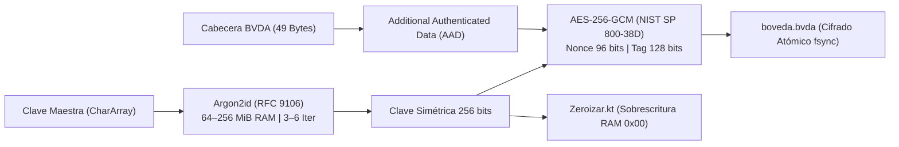
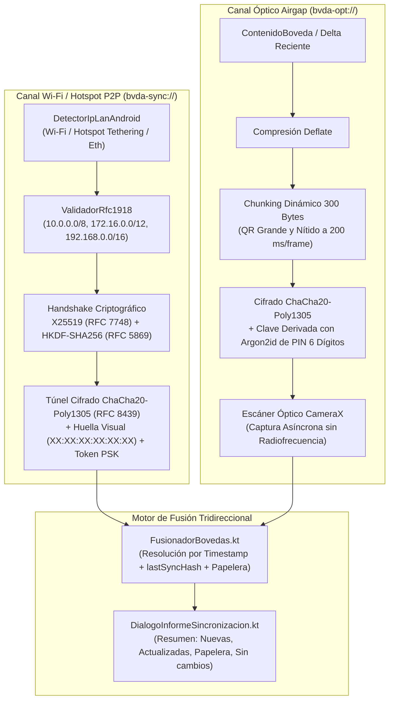
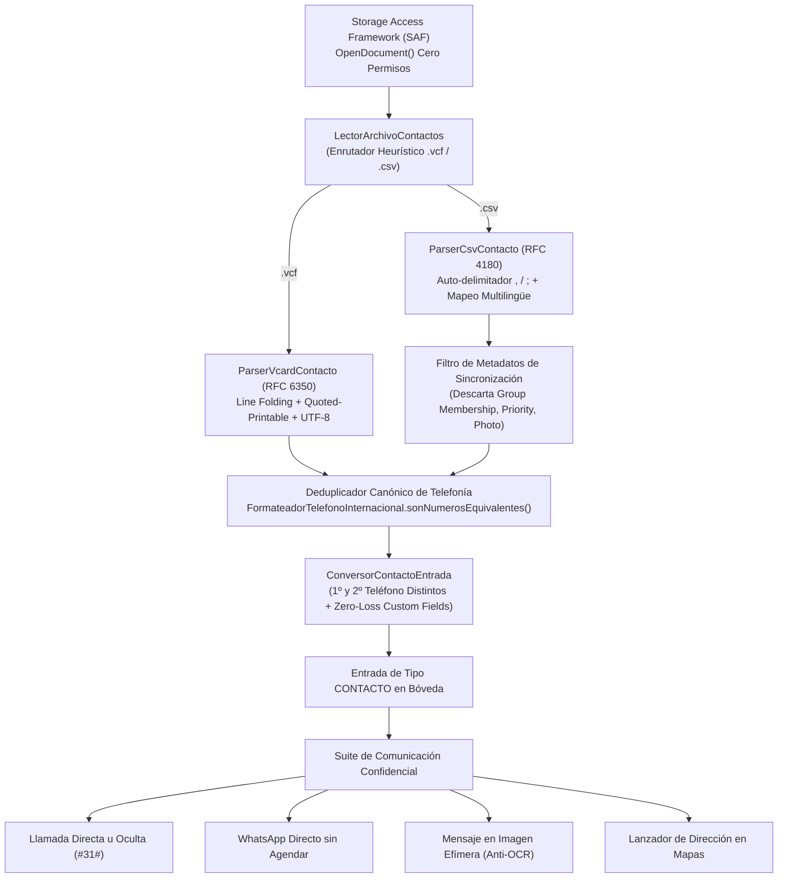

# Bóveda Local

[](https://kotlinlang.org/)
[](https://developer.android.com/jetpack/compose)
[](https://developer.android.com/)
[](https://gradle.org/)
[](https://github.com/)
[](https://github.com/)
[-DEA584.svg?logo=rust&logoColor=white)](https://github.com/jlnavas3/boveda-desktop)
[](https://www.gnu.org/licenses/gpl-3.0)

**Bóveda Local** (`com.jlnavas3.bovedalocal`) es una plataforma soberana de alta seguridad criptográfica y privacidad absoluta para la custodia local de credenciales, autenticación de dos factores (**TOTP RFC 6238**), proveedor nativo de llaves de acceso (**Passkeys / WebAuthn FIDO2**), generador de pares de claves SSH, alias de correo y normalización inteligente de identidades en Android.

Forma parte del ecosistema soberano de Bóveda Local, operando con paridad binaria y criptográfica simétrica con la aplicación de escritorio oficial [**Bóveda Local Desktop**](https://github.com/jlnavas3/boveda-desktop) (desarrollada en Rust con interfaz Slint para Linux y Windows).

La aplicación opera bajo el principio de **Confianza Cero en Red (Zero-Network Architecture)** y ofrece sincronización peer-to-peer cifrada de extremo a extremo sin servidores intermedios, tanto por red local privada (**Wi-Fi / Hotspot RFC 1918**) como por transporte óptico de aislamiento físico (**Airgap por ráfagas QR**).

---

## 🛡️ Sabores de Compilación (Build Flavors) y Permisos

Bóveda Local se distribuye en dos variantes independientes de compilación según las necesidades operativas de seguridad del usuario:

| Característica | Sabor `airgapped` | Sabor `lanSync` |
| :--- | :--- | :--- |
| **Aislamiento Telemático** | **Cero Permisos de Red** (`INTERNET` purgado de raíz). Imposibilidad física de emitir tráfico telemático. | **Frontera RFC 1918 Estricta**. Sockets efímeros P2P locales únicamente. |
| **Sincronización P2P Wi-Fi / Hotspot** | No disponible (hermético). | Sincronización directa P2P (`bvda-sync://`) cifrada con X25519 + ChaCha20-Poly1305. |
| **Transporte Óptico Airgap (QR)** | Sincronización óptica por cámara (`bvda-opt://`) con ráfaga QR y PIN Argon2id. | Sincronización óptica por cámara (`bvda-opt://`) con ráfaga QR y PIN Argon2id. |
| **Importación de Contactos** | Cero permisos (`READ_CONTACTS` eliminado). Ingesta vía SAF (`.vcf` / `.csv`). | Cero permisos (`READ_CONTACTS` eliminado). Ingesta vía SAF (`.vcf` / `.csv`). |
| **Cámara (CameraX)** | Lectura óptica de QR de 2FA, bóvedas, transferencias y passkeys. | Lectura óptica de QR de 2FA, sincronización P2P, bóvedas y passkeys. |
| **Biometría de Hardware** | `USE_BIOMETRIC` (Android Keystore StrongBox / TEE). | `USE_BIOMETRIC` (Android Keystore StrongBox / TEE). |

```xml
<!-- Manifiesto de Seguridad de Bóveda Local: CERO permisos de contactos y aislamiento de red -->
<manifest xmlns:android="http://schemas.android.com/apk/res/android">
    <uses-permission android:name="android.permission.USE_BIOMETRIC" />
    <uses-permission android:name="android.permission.VIBRATE" />
    <uses-permission android:name="android.permission.CAMERA" /> <!-- Visor QR bajo demanda en memoria -->

    <!-- En sabor lanSync únicamente: -->
    <!-- <uses-permission android:name="android.permission.INTERNET" /> (Restringido por software a RFC 1918) -->
</manifest>
```

---

## 🔐 Especificación Criptográfica y Ciclo de Vida

El motor criptográfico de Bóveda Local prescinde de librerías propietarias y se adhiere estrictamente a primitivas avaladas por el NIST y la IETF:



### 1. Derivación de Clave: Argon2id (RFC 9106)
Resistente a ataques de compensación tiempo-memoria (TMTO) y computación masiva en clústeres GPU/ASIC mediante la variante híbrida `Argon2id` (v0x13):
* **Perfil Estándar:** 64 MiB RAM ($65,536\text{ KiB}$), 3 iteraciones, paralelismo = 4 lanes ($\approx 150\text{ ms}$).
* **Perfil Reforzado:** 128 MiB RAM ($131,072\text{ KiB}$), 4 iteraciones, paralelismo = 4 lanes ($\approx 300\text{ ms}$).
* **Perfil Ultra-Seguro:** 256 MiB RAM ($262,144\text{ KiB}$), 6 iteraciones, paralelismo = 4 lanes ($\approx 600\text{ ms}$).

### 2. Cifrado Autenticado: AES-256-GCM con Cabecera AAD
* **Cifrador:** `AES/GCM/NoPadding` con clave simétrica de 256 bits derivada por KDF.
* **Vector de Inicialización (Nonce):** 96 bits (12 bytes) CSPRNG generados individualmente en cada guardado.
* **Cabecera Inmutable Autenticada (49 Bytes):**
  `[MAGIC: 4B ("BVDA")][VERSION: 1B (0x01)][SALT: 16B][MEM: 4B][ITER: 4B][PAR: 4B][LEN: 4B][NONCE: 12B]`.
  La cabecera completa se vincula como **AAD** mediante `cipher.updateAAD(cabecera)`. Cualquier intento de alterar los parámetros de la cabecera produce de inmediato una falla de integridad (`AEADBadTagException`).

### 3. Compresión BLZ1 (Deflate Transparente)
Antes del cifrado AES-GCM, el payload JSON se comprime con el algoritmo Deflate (zlib) precedido por la marca mágica `BLZ1` (`0x42, 0x4C, 0x5A, 0x31`), reduciendo el tamaño en disco en un 50–70% y acelerando la lectura en memoria flash con retrocompatibilidad transparente para bóvedas históricas.

### 4. Gestión y Purga de Memoria Volátil (Zeroización)
Se prohíbe el uso de cadenas inmutables (`java.lang.String`) para secretos. Toda clave o contraseña temporal reside en buffers primitivos (`CharArray`, `ByteArray`) y es inmediatamente sobrescrita con bytes nulos (`0x00`) tras su uso mediante [`Zeroizar.kt`](app/src/main/java/com/jlnavas3/bovedalocal/crypto/Zeroizar.kt).

### 5. Enlace Biométrico con Android Keystore
Al activar el desbloqueo por huella, la clave maestra se cifra y almacena en el Keystore respaldado por hardware seguro (**TEE / StrongBox Keymaster**). La clave solo se libera tras una autenticación biométrica exitosa validada por el framework del sistema mediante `BiometricPrompt.CryptoObject`.

---

## 📡 Sincronización Soberana P2P y Transporte Óptico Airgap

Bóveda Local cuenta con dos canales criptográficos de sincronización directa entre dispositivos (Android ↔ Android y Android ↔ [**Bóveda Local Desktop**](https://github.com/jlnavas3/boveda-desktop)), sin requerir servidores remotos ni cuentas en la nube:



### 1. Protocolo P2P Red Local (`bvda-sync://`)
* **Handshake Asimétrico:** Claves efímeras Curve25519 (**X25519 RFC 7748**) combinadas con derivación de clave **HKDF-SHA256 (RFC 5869)** y cifrado autenticado **ChaCha20-Poly1305 (RFC 8439)**.
* **Token PSK Efímero y Huella Visual:** El anfitrión genera un token de un solo uso (`t`) y una huella de emparejamiento visual de 6 bytes en formato canónico (`7A:97:61:D1:42:0C`) para validar visualmente la sesión entre ambas pantallas.
* **Filtro RFC 1918 Estricto:** La conexión socket se rechaza de inmediato si la dirección IP no pertenece a rangos privados RFC 1918 (`10.0.0.0/8`, `172.16.0.0/12`, `192.168.0.0/16`).
* **Soporte Hotspot Directo:** Permite sincronizar dos teléfonos directamente en cualquier lugar activando el punto de acceso móvil de uno de ellos, sin necesidad de router o conexión a internet.
* **Confirmación Previa de Dispositivo Remoto:** Antes de transferir los datos, ambos extremos intercambian su alias (`aliasDispositivo`, ej. `HONOR DNP-NX9 ↔ Xiaomi 22101320G`) y exigen confirmación interactiva al usuario.

### 2. Transporte Óptico Cifrado Airgap (`bvda-opt://`)
* **Aislamiento Total de Radio:** Cero señales de radiofrecuencia (sin Wi-Fi, sin Bluetooth, sin NFC). Los datos viajan exclusivamente desde la pantalla del dispositivo emisor hacia el sensor de cámara del receptor.
* **Cifrado con PIN de 6 Dígitos:** La ráfaga viaja protegida con ChaCha20-Poly1305, cuya clave simétrica se deriva en tiempo real a partir de un PIN numérico de 6 dígitos mediante **Argon2id** (con sal criptográfica de 16 bytes transmitida en la cabecera).
* **Chunking Elástico de 300 Bytes:** Fragmentación en bloques de 300 bytes binarios que generan códigos QR de módulos grandes y alto contraste, legibles instantáneamente a 5 FPS (200 ms por fotograma).
* **Modo "Cambios Recientes (1 QR)":** Utiliza el cálculo de `lastSyncHash` para identificar exclusivamente entradas activas o de papelera con cambios pendientes, empaquetando el delta en **un único código QR estático**.
* **Modo "Bóveda Completa":** Ráfaga cíclica indexada que el receptor captura en cualquier orden hasta reconstruir el 100% de los fragmentos.

### 3. Fusión Tridireccional sin Pérdidas (*Three-Way Lossless Merge*)
* Comparación matemática por marca de tiempo (`modificadaEn`) campo por campo.
* Preservación inteligente de borrados: si una entrada fue eliminada en un extremo pero modificada posteriormente en el otro, prevalece la modificación más reciente.
* Atribución y actualización atómica del hash de sincronización (`lastSyncHash`) para transacciones incrementales futuras.

---

## 📇 Suite de Contactos Seguros Zero-Permissions

Bóveda Local cuenta con un subsistema completo de gestión y resguardo de contactos confidenciales que prescinde por completo del permiso intrusivo de lectura de contactos (`READ_CONTACTS`):



* **Deduplicación Canónica de Telefonía:** Resuelve automáticamente discrepancias de formato (ej. `+59399-461-5671` vs `+593994615671` o `0994615671`), garantizando que el mismo número físico no se duplique como teléfono secundario ni contamine campos adicionales.
* **Ingesta Zero-Loss:** Cualquier dato presente en el archivo que no corresponda a los campos estándar se preserva intacto en `Campos Personalizados`, filtrando metadatos internos de sincronización en la nube.
* **Comunicación Confidencial Integrada:** Marcación con prefijo de identidad oculta, apertura de chats de WhatsApp directo sin registrar el número en la libreta del sistema, y generación de imágenes efímeras para mensajes confidenciales.

---

## 📦 Tipos de Entrada Nativos y Modelado de Datos

Bóveda Local cuenta con soporte nativo de **9 tipos de entrada** fuertemente tipados con campos específicos y validaciones matemáticas locales:

1. **Credenciales de Acceso (Login):** Usuario, contraseña con medidor de entropía, URLs con favicon local, alias de correo `@`, códigos 2FA TOTP principales y secundarios, llaves de acceso Passkeys vinculadas y campos personalizados.
2. **Tarjetas Bancarias:** Número de tarjeta (PAN) con verificación matemática mediante **Algoritmo de Luhn**, fecha de caducidad (MM/AA), código de seguridad (CVV/CVC), tipo de tarjeta (Crédito, Débito, Prepago) y titular.
3. **Cuentas Bancarias:** Nombre de entidad bancaria, número de cuenta / IBAN con detección de formato de país, código de entidad (BIC/SWIFT) y titular.
4. **Documentos de Identidad:** Tipo de documento (DNI, Pasaporte, Licencia de Conducir, Cédula, NIE, etc.), número de documento, fecha de emisión, fecha de expiración, país emisor y notas asociadas.
5. **Redes Wi-Fi:** Nombre de red (SSID), contraseña de red, tipo de seguridad (WPA2, WPA3, WEP, Abierta) y conmutador de red oculta.
6. **Servidores y Conexiones SSH:** Host/IP, puerto SSH (por defecto 22), usuario, clave privada PEM, clave pública OpenSSH, huella digital SHA-256 y generador integrado de pares asimétricos (Ed25519, RSA 2048/4096, ECDSA).
7. **Billeteras Cripto (Wallets):** Frase semilla mnemónica (BIP-39 de 12 o 24 palabras) con comprobación de diccionario, dirección pública de wallet y red de blockchain asociada.
8. **Contactos Seguros:** Nombre, teléfono principal, teléfono secundario deduplicado, correo, dirección de entrega física, empresa, cargo y suite de comunicación confidencial.
9. **Notas Seguras en Markdown:** Editor estructurado compatible con tablas Markdown completas, listas de verificación `[x]`, bloques de código cifrados, encabezados, citas y alternancia en tiempo real entre edición y previsualización.

---

## 🏛️ Arquitectura de Software y Micro-Diseño

El proyecto adopta **Clean Architecture** estructurada en MVI/MVVM con Jetpack Compose bajo un estricto principio de **Micro-Diseño (1 archivo = 1 componente/clase/función)** y soporte universal de vistas previas con `@BovedaPreview`.

El controlador central [`VaultViewModel.kt`](app/src/main/java/com/jlnavas3/bovedalocal/ui/VaultViewModel.kt) opera como una **Fachada Reactiva** desacoplada en delegados de ciclo y sub-delegados de dominio:

```mermaid
flowchart TD
    VM["VaultViewModel (Facade Central)"]
    
    subgraph Ciclo_Navegacion ["Ciclo, Navegación y CRUD"]
        VM --> D_Nav["VaultViewModelNavegacion<br/>Pila LIFO ArrayDeque + padreDe()"]
        VM --> D_Ent["VaultViewModelEntradas<br/>CRUD, Búsqueda Fonética, Filtros"]
        VM --> D_Cic["VaultViewModelCicloBoveda<br/>Desbloqueo, Autodestrucción, Rate Limit"]
        VM --> D_Bkp["VaultViewModelBackup<br/>SAF, Exportación .bvda, CSV Dinámico"]
        VM --> D_Tit["VaultTitulosDelegate<br/>Normalización de Títulos y Homelab"]
        VM --> D_Dup["VaultDuplicadosPapeleraDelegate<br/>Detección de Duplicados, Lotes y Purga"]
        VM --> D_Avi["VaultAvisosDelegate<br/>Asistencia Interna In-App y Recordatorios"]
    end
    
    subgraph Delegados_Ajustes ["Delegados Especializados de Ajustes"]
        VM --> D_Seg["VaultAjustesSeguridadDelegate<br/>Biometría, Freno Intentos, Wipe"]
        VM --> D_Org["VaultAjustesOrganizacionDelegate<br/>Plantillas Campos, Formatos, Índices"]
        VM --> D_Col["VaultAjustesColoresTemaDelegate<br/>Paletas de Acento, Colores Secciones"]
        VM --> D_Geo["VaultAjustesFormasTipografiaDelegate<br/>Curvatura, Grosor, Tipografía"]
        VM --> D_Eng["VaultAjustesAnimacionEngranajesDelegate<br/>Física y Visual de Engranajes/Puerta"]
        VM --> D_Int["VaultAjustesInteraccionDelegate<br/>Háptica Global, Alumbrado, Registro"]
        VM --> D_Dic["VaultAjustesDiccionariosDelegate<br/>Gestión Diccionarios BIP-39 y Comunes"]
        VM --> D_Wid["VaultAjustesWidgetTotpDelegate / 1x1<br/>Calibración y Vidrio Esmerilado"]
        VM --> D_Til["VaultAjustesTileTotpManualDelegate<br/>Quick Settings Tile y 2FA Manual"]
    end
```



---

## 🎛️ Parametrización Dinámica Total (23 Bloques Canónicos)

Todos los valores predeterminados de la aplicación residen de forma canónica en [`AjustesDefaults.kt`](app/src/main/java/com/jlnavas3/bovedalocal/data/AjustesDefaults.kt). Ninguna constante se encuentra hardcodeada en pantallas o ViewModels:

1. **Seguridad y Acceso:** Modos de biometría (Fuerte Clase 3 vs Compatible Clase 2), tiempo de inactividad (hasta 20 min), borrado de portapapeles y protección FLAG_SECURE.
2. **Seguridad Visual:** Ocultación de contraseñas por defecto y máscaras en pantalla.
3. **Temas y Apariencia:** 20 paletas de acento, paletas sobrias (Gris Acero, Arena, Pizarra, Carbón, Niebla) y capas L1–L4.
4. **Colores de Datos de Tarjeta:** Colores independientes para Usuario, Contraseña, Web, TOTP, Notas, Passkeys, etc.
5. **Colores de Bloques Tri-Grama:** Identidad cromática de cada sección de ajustes.
6. **Formas y Geometría:** Curvatura de esquinas (0–32 dp), estilo de bordes (Delgado, Grueso, Sólido, Neón) y espaciados (6–24 dp).
7. **Tipografía y Textos:** Escala tipográfica, familias sans/serif/mono, grosor de fuente e interlineado proporcional.
8. **Autocompletado e Inline Suggestions:** Pistas heurísticas para usuarios, contraseñas, OTPs, documentos, tarjetas bancarias y direcciones postales.
9. **Animación de Engranajes y Puerta:** Calibración física de giro, radio y destellos.
10. **Widgets TOTP y 1x1:** Calibración de transparencias, curvatura y desenfoque.
11. **Quick Settings Tile:** Parámetros de generación directa desde la cortina de estado.
12. **Lista y Formatos Regionales:** Criterios de ordenación, agrupación por sitio y formatos de fecha/teléfono.
13. **TOTP Manual:** Períodos de tiempo (30s/60s), algoritmos SHA-1/256/512 y número de dígitos.
14. **Historial, Copias y Retención:** Días de recordatorio (con modo de prueba de 30 minutos), copias automáticas y retención en papelera.
15. **UI / Háptica / Alumbrado:** Niveles de vibración sensorial y destellos en navegación profunda.
16. **Normalización de Títulos y Homelab:** Marcas, subdominios descartables, TLDs y rutas de red local `/$ruta → $servicio`.
17. **Generador de Claves y Diceware:** Longitud hasta 128 caracteres, símbolos, exclusión de ambiguos y frases memorables.
18. **Importación CSV y Contactos:** Soporte multidelimitador (`,`, `;`, `\t`, `|`) y enrutador universal `.vcf` / `.csv`.
19. **Diagnóstico y Registro:** Buffer en memoria configurable (100 a 1000 eventos).
20. **Plantillas de Campos:** Plantillas reutilizables del sistema y personalizadas (`PlantillaCamposPersonalizada`).
21. **Cámara y Escáner QR:** Límites de ventana (160–360 dp), respuesta háptica y sonido de captura.
22. **Avisos y Asistencia Interna:** Campana en barra inferior, avisos en pantalla bloqueada y recomendaciones activas.
23. **Transferencia CXF y Sincronización P2P:** Ventana de importación/exportación FIDO Alliance y parámetros de emparejamiento local.

---

## 🏷️ Matriz Funcional y Taxonomía Tri-Grama

Todos los módulos, submódulos y grupos de ajustes responden al estándar semántico de **Tri-Gramas con separación por guiones** (`XX-YYY[-ZZZ]`):

| Bloque Canónico | Mnemónico | Identificadores Destacados | Capacidades Principales |
| :--- | :--- | :--- | :--- |
| **00** | `AJU` | `00-AJU` | **Hub Central de Ajustes:** Vista unificada con tarjetas squircle estilo Samsung One UI 6, buscador en vivo y deep-linking con destello visual puro. |
| **01** | `SEG` | `01-SEG-BIO`, `01-SEG-PAS`, `01-SEG-SNU`, `01-SEG-DES`, `01-SEG-COM` | **Seguridad y Criptografía:** Biometría unificada (`01-SEG-BIO-BLO`), cambio de clave maestra, bóveda señuelo contra coacción, PIN de autodestrucción, límite de intentos fallidos antes de purga y catálogo editable de contraseñas comunes. |
| **02** | `APA` | `02-APA-THM`, `02-APA-GEO`, `02-APA-TYP`, `02-APA-ANI`, `02-APA-PLT` | **Personalización Visual:** Laboratorio de temas, capas L1-L4, esquinas (0–32 dp), bordes, tipografías, animación relojera y plantillas de campos reutilizables. |
| **03** | `LST` | `03-LST-AZX`, `03-LST-SLD`, `03-LST-DUP`, `03-LST-PAP`, `03-LST-TIT`, `03-LST-RGL` | **Gestión de Bóveda:** Barra de acciones inferior fija, índice alfabético Niagara, swipe horizontal, modo comparación entre cuentas, auditoría de salud, normalizador de títulos/homelab y papelera con borrado/restauración por lotes. |
| **04** | `HER` | `04-HER-GEN`, `04-HER-2FA`, `04-HER-HST`, `04-HER-WGT`, `04-HER-DIC`, `04-HER-PSK` | **Herramientas de Productividad:** Generador CSPRNG hasta 128 caracteres, frases Diceware BIP-39 bilingües, Autenticador TOTP RFC 6238 con códigos secundarios, claves SSH, passkeys y escáner QR regulable. |
| **05** | `COP` | `05-COP-EXP`, `05-COP-ATM`, `05-COP-MAN`, `05-COP-REC`, `05-COP-CNT-IMP` | **Copias y Transferencias:** Exportación selectiva y manual (.bvda), modo Dry-Run, copias automáticas SAF, sincronización P2P / Óptica Airgap e importador universal de contactos (.vcf/.csv). |
| **06** | `SIS` | `06-SIS-DGN`, `06-SIS-LOG`, `06-SIS-APP`, `06-SIS-LIC`, `06-SIS-AYU`, `06-SIS-AVZ-ORG` | **Sistema y Auditoría:** Diagnóstico de hardware/SoC, registro de eventos offline, Centro de Ayuda completo (36 artículos), reorganización fractal drag & drop de ajustes, visor legal GPLv3 y kit de emergencia imprimible en PDF. |

---

## ⚙️ Integración con Servicios del Sistema Android

1. **Android Autofill Framework (`AutofillService`):**
   - Intercepta solicitudes del sistema operativo en formularios de login, tarjetas bancarias y direcciones.
   - Detecta el nombre amigable de apps instaladas y presenta sugerencias en `RemoteViews` con ícono circular real y compatibilidad con sugerencias inline en el teclado (IME).
2. **Credential Provider Platform (Android 14+ / API 34+):**
   - Actúa como proveedor nativo de **Passkeys** y credenciales FIDO2/WebAuthn. Procesa peticiones codificadas en CBOR, genera aserciones firmadas con curvas elípticas NIST P-256 (ES256) y despliega el nombre e ícono real de la app en la hoja del sistema.
3. **Asociación de Archivos de Copia Cifrada (`.bvda`):**
   - Integra un `intent-filter` en el manifiesto para asociar y abrir directamente archivos `.bvda` desde el gestor de archivos de Android con modo de inspección previa (*Dry-Run*).
4. **Panel de Ajustes Rápidos (`TileService`):**
   - Incluye un Quick Settings Tile en la cortina de notificaciones de Android para generar contraseñas criptográficas instantáneas sin necesidad de desbloquear la aplicación.
5. **Widgets de Escritorio:**
   - Widget interactivo para visualización de códigos TOTP 2FA con cuenta atrás reactiva y vidrio esmerilado.
   - Widget 1x1 para generación rápida de credenciales al toque.
6. **Mitigación Visual de Capturas (`FLAG_SECURE`):**
   - Activo de forma predeterminada para impedir capturas de pantalla, grabaciones de video y ocultar la previsualización de la bóveda en la ventana de apps recientes.

---

## 🛠️ Ingeniería de Compilación y Calidad

### Requisitos del Entorno
* **JDK:** OpenJDK 25 (o Java 17 / 21 LTS) verificado y compilado bajo Gradle 9.8 + AGP 9.4.
* **Android SDK:** `compileSdk = 36`, `minSdk = 29` (Android 10+), `targetSdk = 35` (Android 15).
* **Compilador:** Kotlin 2.4 (Plugins Compose Compiler y Serialization v2.4.21).

### Comandos de Gradle

```bash
# Ejecutar la batería de pruebas unitarias automatizadas (690 tests)
./gradlew testLanSyncDebugUnitTest testAirgappedDebugUnitTest

# Construir binarios Release para el sabor de sincronización local (Wi-Fi P2P + Óptico)
./gradlew assembleLanSyncRelease

# Construir binarios Release para el sabor ultra-soberano hermético (Airgapped)
./gradlew assembleAirgappedRelease

# Inspección de versión del proyecto
./gradlew mostrarVersion
```

### Despliegue Dual en Dispositivos Físicos mediante ADB
```bash
# Instalación en dispositivo anfitrión primario (ej. Honor Magic)
adb -s <SERIAL_PRIMARIO> install -r app/build/outputs/apk/lanSync/release/app-lanSync-arm64-v8a-release.apk

# Instalación en dispositivo cliente secundario (ej. Xiaomi / Redmi)
adb -s <SERIAL_SECUNDARIO> install -r app/build/outputs/apk/lanSync/release/app-lanSync-arm64-v8a-release.apk
```

---

## 📄 Licencia

Este proyecto se distribuye bajo la licencia de código abierto **GNU General Public License v3.0 (GPLv3)**. Consulta el archivo [`LICENSE`](LICENSE) para ver los términos legales completos.

### 🛡️ Política de Atribución y Protección de Marca
* **Atribución Inviolable**: La autoría original a **Jose Luis Navas** debe permanecer explícita en cualquier redistribución o trabajo derivado.
* **Copyleft Fuerte**: Cualquier modificación, biblioteca o proyecto derivado que utilice este código debe publicarse obligatoriamente bajo los términos de la misma licencia GPLv3 y con código fuente abierto. Queda terminantemente prohibido cerrar o privatizar el código derivado.
* **Protección de Marca e Identidad Visual (Sección 7(e) GPLv3)**: El nombre comercial *"Bóveda Local"*, el identificador de paquete `com.jlnavas3.bovedalocal`, el logotipo oficial, la iconografía y la identidad visual de la aplicación son marcas y propiedad intelectual exclusiva de Jose Luis Navas. Esta licencia **no autoriza** el uso del nombre ni del logotipo para denominar, promocionar o distribuir proyectos derivados o forks sin consentimiento previo por escrito.
